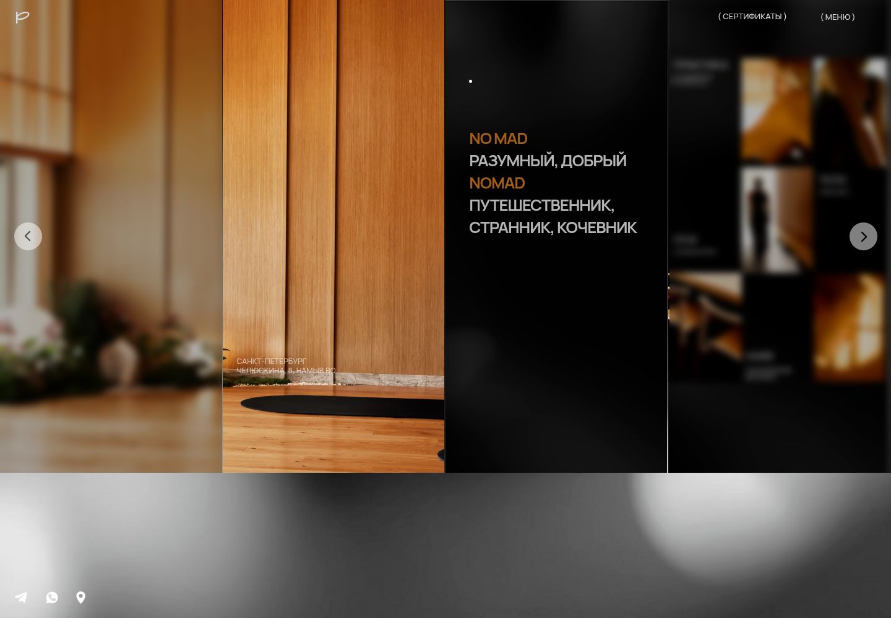
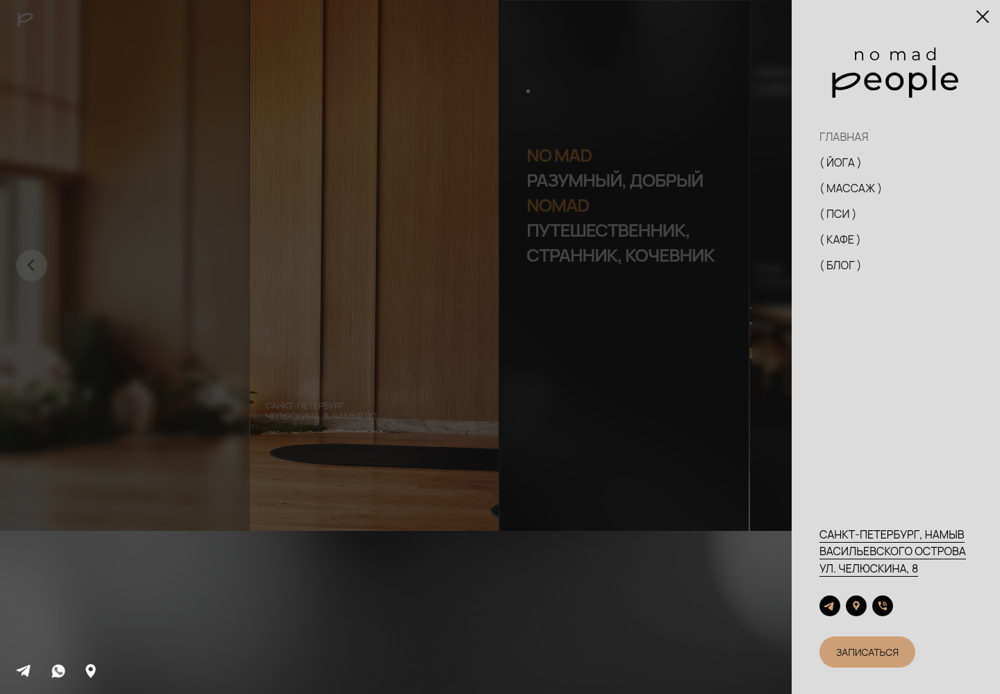
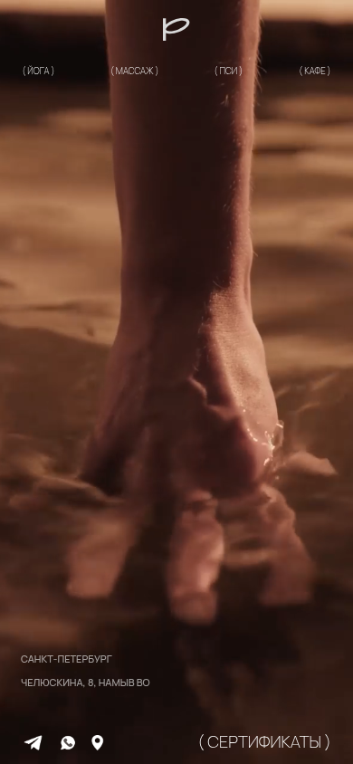
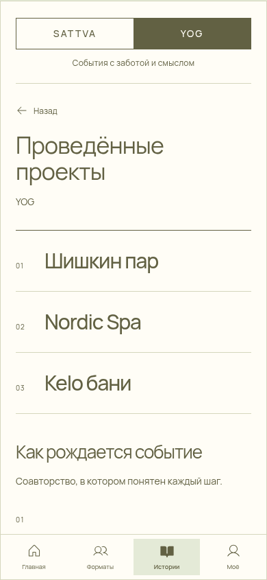
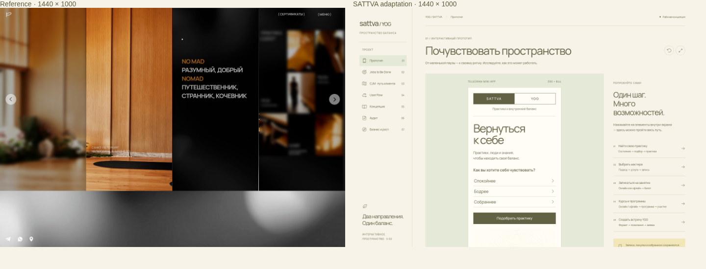
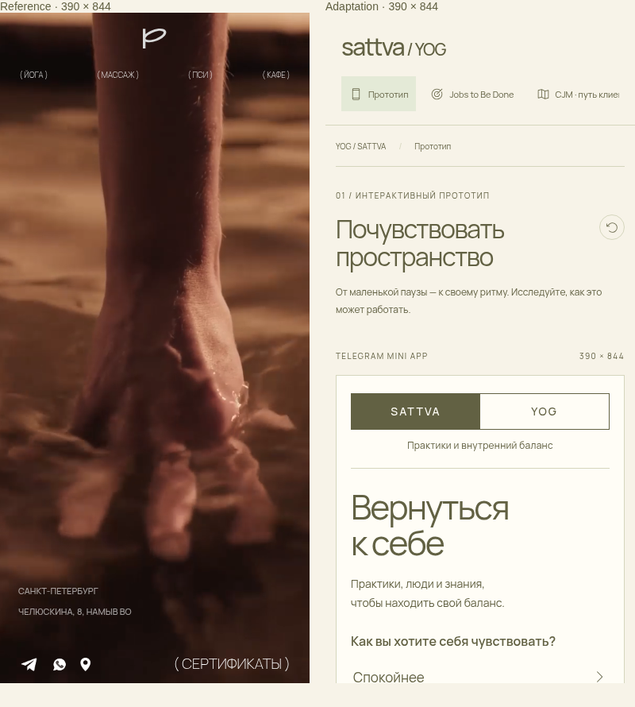

# Визуальный аудит nomadpeople.ru и адаптация SATTVA / YOG

Дата: 16 ноября 2026. Референс: https://nomadpeople.ru/.

Это адаптация визуальных приёмов к существующему приложению, а не копия сайта студии. Сохранены навигация SATTVA / YOG, каталог, курсы, запись, демонстрационная покупка, личный раздел и аналитические разделы.

## 1. Первый экран на компьютере — выразительный, с риском потери навигации

Хорошо работают вертикальные деления, сдержанный геометрический шрифт Manrope, короткие подписи и отсутствие лишних карточек. Фотографии и движение создают атмосферу. На зафиксированном кадре небольшие светлые подписи лежат поверх разных по яркости участков изображения: читаемость зависит от кадра. Некоторые направления легче найти через меню, чем на первом экране.

Перенос: Manrope с локальным файлом шрифта и лицензией OFL, крупные заголовки, плоские поверхности, тонкие разделители, единые поля. В приложении сохранены видимые подписи действий и навигация; фон под текстом однотонный.

## 2. Открытое меню на компьютере — понятно, но требует отдельного действия

Разделы перечислены коротко, контакты и действие записи отделены большим свободным пространством. Состояние открытого меню визуально понятно, фон затемняется. Подписи социальных ссылок не объясняют назначение без узнавания иконки; скриншот не доказывает доступность их названий для скринридера.

Перенос: спокойный ритм бокового меню, короткие подписи, минимум декора. В приложении оставлены текстовые названия разделов, выбранное состояние, видимый клавиатурный фокус и существующие сценарные ссылки.

## 3. Первый экран на телефоне — атмосферный, менее предсказуемый при загрузке

Полноэкранный видеокадр и компактные подписи сохраняют минимализм. При первом захвате вместо содержимого ещё отображался индикатор загрузки; этот кадр отклонён и не использован как финальное доказательство. После загрузки экран был захвачен повторно. Мелкие подписи на изображении остаются потенциальным риском для читаемости. Это наблюдение одного сеанса, а не замер производительности сайта.

Перенос: свободная подача и единая типографика без обязательного видео перед началом работы. На ширинах 375, 390, 768, 1024 и 1440 CSS px проверено отсутствие горизонтального переполнения страницы; внутренние таблицы и меню сохраняют собственную прокрутку.

## Палитра приложения

| Назначение | Цвет |
| --- | --- |
| Текст, иконки, основные кнопки | Оливковый `#626143` |
| Второстепенные подписи | `#68674b` |
| Основной фон | Слоновая кость `#f7f3e8` |
| Поверхности приложения | Молочный `#fffdf6` |
| Подложка и выбранные разделы | Пастельный зелёный `#e4ead7` |
| Мягкие акценты | Тёплый жёлтый `#f1e6b8` |
| Разделители | `#d5d6bd` |

Чёрные и серые цвета интерфейса заменены, включая состояния кнопок, тени и favicon. Старые исходные скриншоты аудита сохранены без изменения файлов, а в интерфейсе показываются с тёплым тонированием. Фотографии референса не перенесены в продукт.

## YOG

Добавлены только названия проведённых проектов, сообщённые владельцем: «Шишкин пар», Nordic Spa, Kelo бани. Даты, состав услуг, число участников, результаты, отзывы и фотографии не добавлялись. Вымышленные иллюстрации прежнего раздела удалены. Процесс подготовки события показан отдельно от списка проектов. Название направления — YOG.

## Сравнение и границы проверки

Сравниваются визуальные приёмы и адаптация, а не одинаковые пользовательские задачи: сайт референса представляет студию, приложение показывает интерактивную систему практик и событий. Полноэкранное видео и тёмные фотографии намеренно не переносились.

Скриншоты получены в текущем сеансе системным Chromium через Playwright: отдельные инструменты управления общим браузером не были доступны. Проверка TLS не отключалась. Отдельно проверены браузерные сценарии, цвета CSS, загрузка шрифта, адаптивность и клавиатурный фокус. Полная проверка WCAG, всех сторонних страниц референса и поведения со скринридером не проводилась.
